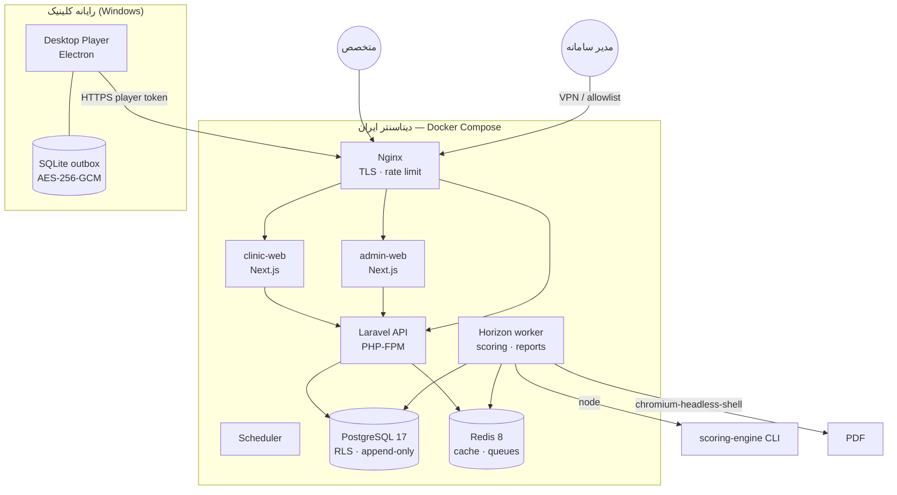
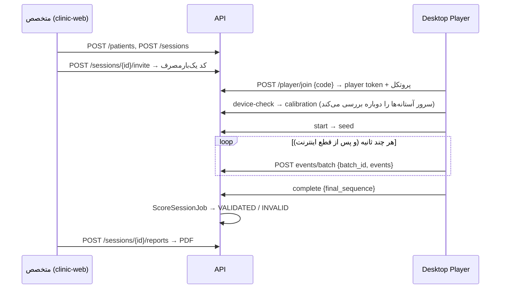

# معماری Cognitest

> سکوی مستقل ارزیابی شناختی · بازار ایران · اجرای آزمون روی دسکتاپ · مدل چندکلینیکی (Multi-Tenant SaaS)

## نمای کلان



## تصمیم‌های کلیدی (ADR خلاصه)

| #   | تصمیم                                                              | دلیل                                                                      | پیامد                                                                                      |
| --- | ------------------------------------------------------------------ | ------------------------------------------------------------------------- | ------------------------------------------------------------------------------------------ |
| 1   | **Modular Monolith** به‌جای Microservice                           | تیم کوچک، دامنه منسجم، هزینه عملیاتی پایین                                | مرز ماژول‌ها در `app/Domain/*`؛ در صورت نیاز، Scoring و Reports اولین کاندیدای جداسازی‌اند |
| 2   | **Electron Desktop Player** به‌جای تب مرورگر                       | کنترل پنجره/تمام‌صفحه/kiosk، جلوگیری از throttling، ذخیره‌سازی آفلاین امن | تأخیر سخت‌افزاری حذف نمی‌شود؛ کالیبراسیون و اعتبارسنجی زمانی الزامی است                    |
| 3   | **یک موتور آزمون TypeScript** مشترک (`packages/assessment-engine`) | یک پیاده‌سازی برای پلیر، تست‌ها و شبیه‌سازی                               | موتور به پلتفرم وابسته نیست (ports & adapters) و بدون مرورگر تست می‌شود                    |
| 4   | **Scoring در TypeScript، اجرا از Laravel با Node CLI**             | الگوریتم فقط یک‌جا نوشته می‌شود؛ نسخه‌بندی‌شده و قطعی                     | worker به Node نیاز دارد؛ خروجی هر run با `algorithm_version` ذخیره می‌شود                 |
| 5   | **Multi-tenancy دو لایه**: Eloquent scope + PostgreSQL RLS         | دفاع در عمق؛ حتی SQL خام هم داده کلینیک دیگر را نمی‌بیند                  | برنامه با نقش غیرمالک `cognitest_app` به DB وصل می‌شود؛ مهاجرت با نقش مالک                 |
| 6   | **داده خام Append-only** (trigger)                                 | امکان بازتحلیل، ممیزی و دفاع علمی                                         | اصلاح/تفسیر فقط با رکورد جدید (scoring run / report version جدید)                          |
| 7   | **Outbox محلی رمزنگاری‌شده + Sync با batch_id**                    | اینترنت ناپایدار؛ تحویل دقیقاً یک‌بار                                     | سرور idempotent و sequence-checked است                                                     |
| 8   | **BFF برای پنل‌ها** (توکن در کوکی httpOnly)                        | توکن هرگز در دسترس JavaScript مرورگر نیست                                 | فراخوانی API فقط از سرور Next.js                                                           |
| 9   | **میزبانی در ایران و بدون وابستگی به سرویس‌های خارجی**             | تحریم/فیلترینگ و الزامات داده سلامت                                       | فونت، نمودار و PDF همه self-hosted                                                         |

## ماژول‌ها

```
apps/
  api/             Laravel 13 — Tenancy, Patients, Sessions, Events, Scoring, Reports, Admin
  clinic-web/      پنل کلینیک (Next.js 16، RTL)
  admin-web/       پنل مدیریت کل
  desktop-player/  Electron — اجرای آزمون
packages/
  shared-types     انواع دامنه و ماشین حالت جلسه (منبع واحد؛ PHP با تست parity هماهنگ می‌شود)
  validation       قرارداد سیمی (zod) + JSON Schema
  timing-core      ساعت یکنواخت، آمار، PRNG بذرپذیر
  event-recorder   ثبت append-only، Outbox، SyncWorker
  calibration      اندازه‌گیری نمایشگر/ورودی/صدا و داوری
  assessment-engine موتور فریم‌محور + timeline قطعی
  stimulus-renderer رندر DOM محرک‌ها
  audio-engine     پیاده‌سازی Web Audio
  scoring-engine   شاخص‌ها و کنترل کیفیت اجرا (نسخه‌دار)
  report-schema    قالب سند گزارش و برچسب‌های فارسی
  ui               کیت کامپوننت RTL
```

## جریان کار



جزئیات: [مدل زمان‌بندی](timing-model.md) · [پایگاه داده](../database/README.md) · [API](../api/openapi.yaml) · [اعتبارسنجی](../validation/README.md) · [استقرار](../operations/deployment.md)
