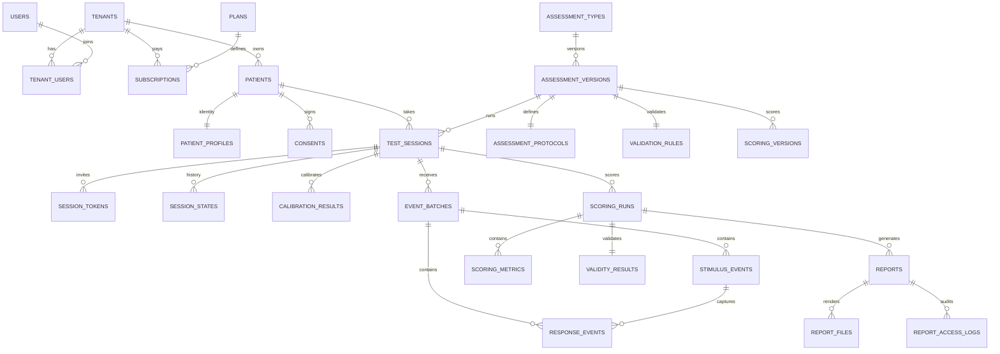

# طراحی پایگاه داده (PostgreSQL 17)

شش حوزه، همه با شناسه UUID (نسخه ۷، مرتب‌شونده بر اساس زمان) به‌جز جداول حجیم رویداد که `bigint identity` دارند.
هر جدول متعلق به کلینیک ستون `tenant_id` دارد و زیر **Row-Level Security** است.

| حوزه              | جداول                                                                                                                                    | نکات                                                                                                                  |
| ----------------- | ---------------------------------------------------------------------------------------------------------------------------------------- | --------------------------------------------------------------------------------------------------------------------- |
| A. کلینیک و کاربر | `tenants`, `tenant_settings`, `users`, `tenant_users`, `roles`, `permissions`, `permission_role`, `plans`, `subscriptions`, `audit_logs` | قیمت‌ها به ریال؛ نقش‌ها و مجوزها از enumها seed می‌شوند                                                               |
| B. مراجعه‌کننده   | `patients`, `patient_profiles`, `guardians`, `consents`, `patient_notes`                                                                 | هویت جدا از داده آزمون؛ کد ملی/تلفن/یادداشت **رمزنگاری** + blind index (HMAC) برای جستجوی دقیق؛ `pseudonym` برای آمار |
| C. تعریف آزمون    | `assessment_types`, `assessment_versions`, `assessment_protocols`, `stimulus_assets`, `scoring_versions`, `validation_rules`             | نسخه منتشرشده **تغییرناپذیر** (trigger)                                                                               |
| D. جلسات          | `test_sessions`, `session_tokens`, `device_profiles`, `calibration_results`, `session_states`                                            | فقط hash توکن‌ها ذخیره می‌شود؛ تاریخچه وضعیت append-only                                                              |
| E. رویداد خام     | `event_batches`, `stimulus_events`, `response_events`, `session_events`                                                                  | `DOUBLE PRECISION`، زمان برنامه‌ریزی‌شده و واقعی جدا، `UNIQUE(session_id, sequence_number)`، append-only              |
| F. نتایج          | `scoring_runs`, `scoring_metrics`, `validity_results`, `reports`, `report_files`, `report_access_logs`                                   | هر run با `algorithm_version`؛ گزارش‌ها نسخه‌دار و snapshot                                                           |

## تضمین‌های سطح پایگاه داده

- **RLS** (`2026_01_01_000700`): سیاست `tenant_isolation` با تابع `app_tenant_visible(tenant_id)` روی ۲۳ جدول.
  بدون `app.tenant_id` هیچ ردیفی دیده نمی‌شود (fail-closed). زمینه سیستمی صراحتاً `app.bypass_rls=on` می‌گذارد.
- **Append-only** (`2026_01_01_000800`): `UPDATE` روی جداول رویداد، تاریخچه وضعیت و audit با خطا رد می‌شود.
- **تغییرناپذیری پروتکل**: `UPDATE/DELETE` روی تعریف نسخه‌ای که `draft` نیست رد می‌شود.

## نقش‌ها

| نقش             | کاربرد                                                     |
| --------------- | ---------------------------------------------------------- |
| `cognitest`     | مالک schema؛ فقط برای migration (`--database=pgsql_owner`) |
| `cognitest_app` | اتصال runtime (PHP-FPM, worker)؛ تابع RLS                  |

## حجم و نگهداشت

یک جلسه ۷ دقیقه‌ای نمایشی ≈ ۶۰۰ رویداد (~۲۰۰ KB با ایندکس). برای ۱۰۰٬۰۰۰ جلسه در سال حدود ۲۰ GB.
در مرحله رشد، `stimulus_events`/`response_events` را بر اساس زمان پارتیشن کنید (کلید `session_id` ثابت می‌ماند).
